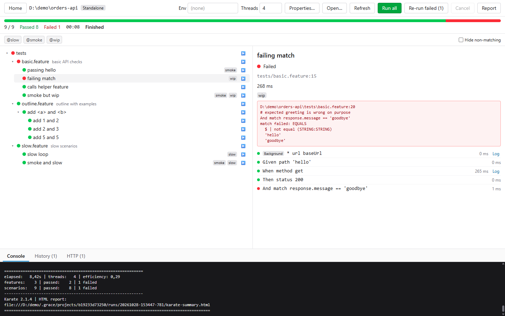

  <picture>
    <source media="(prefers-color-scheme: dark)" srcset="assets/banner-dark.svg">
    
  </picture>

  
  
  

I'm a .NET software engineer at [Swiss International Air Lines](https://www.swiss.com) in Basel, now Tech Lead on UDH. I build backend services, care about how they ship and run in the cloud, and write open-source developer tools in my spare time.

## Now building

<table>
  <tr>
    <td width="220" align="center">
      
    </td>
    <td>
      <h3><a href="https://github.com/hpagniez/grace">Grace</a></h3>
      
A free, open-source desktop test runner for <a href="https://docs.karatelabs.io/">Karate</a> v2. Browse, filter and run your API tests, watch them live and inspect every HTTP call. Java and Karate come bundled, so there is nothing else to install.

      

        
        
        
      

    </td>
  </tr>
</table>

<picture>
  <source media="(prefers-color-scheme: dark)" srcset="assets/grace-run-dark.png">
  
</picture>

## Experience

**Swiss International Air Lines** · Basel, Switzerland · hybrid

| Role | Team | Dates | Stack |
|---|---|---|---|
| **Tech Lead** | UDH | Sep 2026 – now | Java, Spring Boot |
| **Application Engineer** | CRM Platform | Dec 2024 – now | ASP.NET Core, Dapper |
| **Application Engineer Trainee** | CRM Platform | Jun – Nov 2024 | .NET, Azure DevOps |

As a trainee I built a release management tool from scratch (API and web UI) on top of the Azure DevOps API.

## Toolbox

<table>
  <tr>
    <td><b>Build</b></td>
    <td>
      <picture>
        <source media="(prefers-color-scheme: dark)" srcset="https://skillicons.dev/icons?i=cs%2Cdotnet%2Cjava%2Cspring%2Cts%2Celectron%2Csolidjs&theme=dark">
        
      </picture>
    </td>
  </tr>
  <tr>
    <td><b>Data</b></td>
    <td>
      <picture>
        <source media="(prefers-color-scheme: dark)" srcset="https://skillicons.dev/icons?i=postgres%2Credis%2Cmongodb%2Ckafka%2Crabbitmq%2Celasticsearch&theme=dark">
        
      </picture>
    </td>
  </tr>
  <tr>
    <td><b>Ship</b></td>
    <td>
      <picture>
        <source media="(prefers-color-scheme: dark)" srcset="https://skillicons.dev/icons?i=azure%2Caws%2Cdocker%2Cterraform%2Cansible%2Cgithubactions%2Cgrafana%2Cprometheus&theme=dark">
        
      </picture>
    </td>
  </tr>
</table>

## Earlier

**Olympus**: backend lead on a NosTale private server written from scratch with a team of IT students. .NET, gRPC, RabbitMQ, PostgreSQL, MongoDB, ELK, Terraform, Ansible and GitLab CI, across OVH, Scaleway, AWS and GCP.
